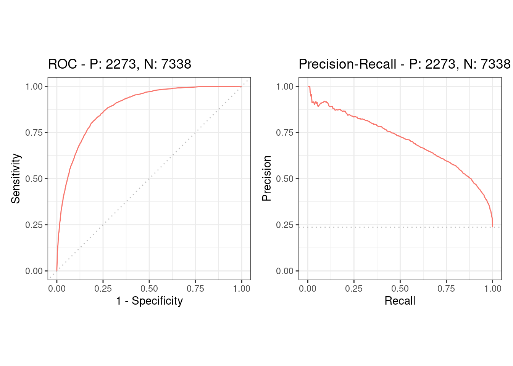
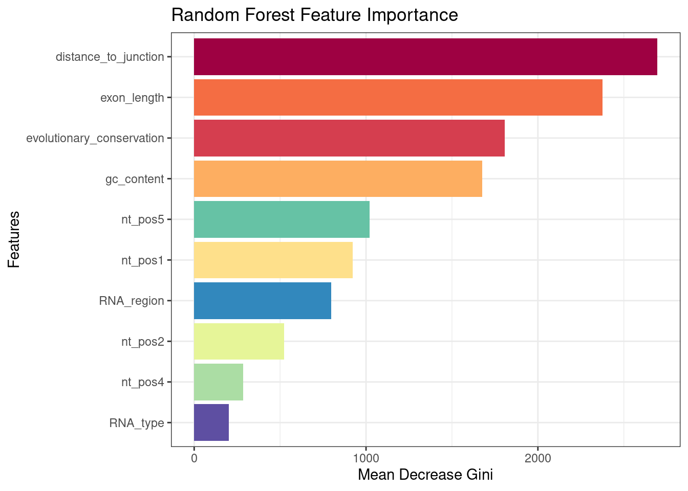

# m6APrediction

**Random-forest prediction of candidate N6-methyladenosine (m6A) RNA modification sites**

`m6APrediction` is an R package for estimating the probability that a candidate RNA site belongs to the **Positive (m6A)** class. It combines local sequence context with transcript-level and genomic features, and provides simple functions for **single-site** and **batch** prediction.

The package includes a pretrained random-forest model and a 100-row example dataset. **No model training is required to run the examples.**

> **Scope:** This is an educational, research-oriented prediction tool. Its outputs are candidate scores, **not experimental confirmation of m6A modification**. Performance presented here comes from a held-out course dataset, not independent validation across species, sequencing technologies, or cellular contexts.

## At a glance

| Item | Details |
|:--|:--|
| Main functions | `prediction_single()` and `prediction_multiple()` |
| Input | RNA/genomic features and a five-nucleotide DNA-alphabet sequence context (`DNA_5mer`) |
| Output | Predicted Positive-class probability and `Positive` / `Negative` label |
| Model | Pretrained random forest, stored in `inst/extdata/rf_fit.rds` |
| Example data | `inst/extdata/m6A_input_example.csv` (100 rows) |
| Default decision threshold | `0.5` (a site is Positive if its probability **exceeds** the threshold) |
| R version declared by the package | R >= 3.5.0; compatibility on every older R version has **not** been independently tested |

## Installation

### Option A — Install directly from GitHub (recommended)

1. Install [R](https://cran.r-project.org/) and optionally [RStudio](https://posit.co/download/rstudio-desktop/).
2. Open the **R Console** in RStudio (not a Markdown document).
3. Run the following commands in your R console:

```r
# Install remotes once, if needed
install.packages("remotes")

# Install m6APrediction from GitHub
remotes::install_github("mumuzishuo/m6APrediction", upgrade = "never")

# Load the installed package
library(m6APrediction)
```
You can also use `devtools::install_github("mumuzishuo/m6APrediction")` if `devtools` is installed. **The GitHub repository must already be published**, and your account must have permission to access it. If it is public, no GitHub login is ordinarily needed for installation.

**Confirm installation:**

```r
packageVersion("m6APrediction")
?prediction_multiple
?prediction_single
```

The current course package declares version `1.0.0`. The two `?` commands should open the functions' help pages.

### Option B — Install from a downloaded package archive

If you have the **built R package** file (for example, `m6APrediction_1.0.0.tar.gz`), install it using:

```r
install.packages(file.choose(), repos = NULL, type = "source")
library(m6APrediction)
```

Select the `.tar.gz` file in the file chooser. This is a **built package archive**, not simply a ZIP of the GitHub folder. Source-package installation still requires R and suitable dependencies; some platforms may need additional build tools.

## Quick start: run the included model

### 1. Load the pretrained model and example input

The package includes these files so that you **do not need to know the installation path** or manually download training data:

```r
library(m6APrediction)

model_file <- system.file(
  "extdata", "rf_fit.rds",
  package = "m6APrediction", mustWork = TRUE
)

example_file <- system.file(
  "extdata", "m6A_input_example.csv",
  package = "m6APrediction", mustWork = TRUE
)

ml_fit <- readRDS(model_file)
example_data <- read.csv(example_file, stringsAsFactors = FALSE)

head(example_data, 3)
```

`readRDS()` loads the fitted model, while `read.csv()` loads example rows with the seven required predictor columns. You are **using an existing model**, not retraining it.

### 2. Predict several sites at once

`prediction_multiple()` accepts a data frame with one candidate site per row and adds two prediction columns:

```r
# Score the first five example sites
batch_result <- prediction_multiple(
  ml_fit = ml_fit,
  feature_df = example_data[1:5, ],
  positive_threshold = 0.5
)

# Inspect the main outputs
batch_result[, c(
  "DNA_5mer", "predicted_m6A_prob", "predicted_m6A_status"
)]
```

**How to read the output:**

| Output column | Meaning |
|:--|:--|
| `predicted_m6A_prob` | Model score for the `Positive` class, between 0 and 1 |
| `predicted_m6A_status` | `Positive` if score > `positive_threshold`, otherwise `Negative` |

The returned data frame also retains the original input columns. A high model score indicates stronger model support for the Positive label; **it is not a biochemical measurement or necessarily a calibrated probability of true modification**.

### 3. Predict one site

`prediction_single()` takes the same information as individual function arguments. To avoid guessing input values, the example below uses **the first row of the bundled CSV**:

```r
site <- example_data[1, ]

single_result <- prediction_single(
  ml_fit = ml_fit,
  gc_content = site$gc_content,
  RNA_type = site$RNA_type,
  RNA_region = site$RNA_region,
  exon_length = site$exon_length,
  distance_to_junction = site$distance_to_junction,
  evolutionary_conservation = site$evolutionary_conservation,
  DNA_5mer = site$DNA_5mer,
  positive_threshold = 0.5
)

single_result
```

**Important output detail:** `prediction_single()` returns a **named character vector**, because the numeric score and text label are combined in one vector. If you need the score as a number:

```r
score <- as.numeric(single_result["predicted_m6A_prob"])
label <- unname(single_result["predicted_m6A_status"])

score
label
```

### 4. Save batch predictions to CSV (optional)

```r
all_results <- prediction_multiple(ml_fit, example_data)
write.csv(all_results, "m6A_predictions.csv", row.names = FALSE)
```

This writes the prediction table into your current working directory. It does not modify the model or the example data stored inside the installed package.

## Required input features

Each row passed to `prediction_multiple()` must contain **all seven columns** below. Column names are case-sensitive.

| Column | Expected form | What it represents |
|:--|:--|:--|
| `gc_content` | Numeric | GC-content feature supplied to the classifier |
| `RNA_type` | Categorical: `mRNA`, `lincRNA`, `lncRNA`, `pseudogene` | Transcript biotype |
| `RNA_region` | Categorical: `CDS`, `intron`, `3'UTR`, `5'UTR` | Region of the transcript |
| `exon_length` | Numeric, already log2-transformed | Exon-length feature on the same scale as the bundled example data |
| `distance_to_junction` | Numeric, already log2-transformed | Distance-to-junction feature on the same scale as the bundled example data |
| `evolutionary_conservation` | Numeric | Conservation-score predictor |
| `DNA_5mer` | Character, exactly five `A/T/C/G` letters | Local sequence context around the candidate site |

The function converts `RNA_type` and `RNA_region` to factors, splits the sequence context into `nt_pos1` ... `nt_pos5`, and passes the features to the saved random forest. The fitted classifier uses positions **1, 2, 4 and 5** of the five-mer (as well as the other predictors). The candidate A is conventionally at the centre of the five-mer; use the data representation shown in the provided CSV.

**Before using your own data:** Make sure sequence lengths, feature names, category values and numeric transformations match those in the example/training data. The functions check for missing column *names* but do not fully validate all biological or numeric assumptions.

## Decision threshold: what changes?

By default, a site is labelled Positive only when its model score is **strictly greater than 0.5**. You can set a different threshold:

```r
more_sensitive <- prediction_multiple(
  ml_fit, example_data,
  positive_threshold = 0.1
)

more_selective <- prediction_multiple(
  ml_fit, example_data,
  positive_threshold = 0.7
)
```

Lowering the threshold usually identifies more candidate positives (**higher recall**) but also increases false positives. Raising the threshold is more selective but can miss genuine positives. Thresholds should be chosen based on the objective and checked on appropriate validation data, rather than treated as universally optimal.

## Model performance: evaluation on a held-out dataset

The associated course evaluation used an imbalanced m6A dataset of **48,055 labelled sites**, with an **80% training / 20% test split**. The test subset contained **9,611 sites**: 2,273 Positive and 7,338 Negative. The model in that evaluation used **500 random-forest trees**.

| Evaluation metric | Result | How to interpret it |
|:--|--:|:--|
| **AUROC** | **0.8871** | Overall ability to rank positive sites above negative sites across thresholds |
| **AUPRC** | **0.7074** | Precision–recall performance, particularly relevant for an imbalanced dataset |
| Positive prevalence in test data | 0.2365 | Reference precision of a random ranking, shown as the dotted PR baseline |
| Accuracy at threshold 0.5 | 0.8394 | Fraction of all test labels classified correctly |
| Precision at threshold 0.5 | 0.7031 | Fraction of predicted positives that were labelled positive |
| Recall at threshold 0.5 | 0.5552 | Fraction of actual positives identified |
| False positive rate at threshold 0.5 | 0.0726 | Fraction of actual negatives incorrectly classified positive |



*Figure 1. ROC (left) and precision–recall (right) curves reproduced from the associated coursework HTML analysis. The grey ROC diagonal represents random ranking; the dotted PR baseline is the test-set Positive prevalence (2,273 / 9,611 ≈ 0.2365). Curves were calculated on held-out data, **not an independent external dataset**.*

**Why both curves?** ROC shows the trade-off between sensitivity (recall) and false-positive rate. Precision–recall is especially informative when Positive cases are less common: it shows how many called sites are truly labelled Positive while recall increases.

### Threshold trade-off in the held-out test set

| Threshold | Precision | Recall | False positive rate | Accuracy |
|--:|--:|--:|--:|--:|
| 0.1 | 0.4302 | 0.9380 | 0.3848 | 0.6915 |
| 0.5 | 0.7031 | 0.5552 | 0.0726 | 0.8394 |

At **0.1**, the classifier finds many more labelled positives, but also produces substantially more false positives. At **0.5**, it selects fewer candidates with higher precision. Neither threshold is necessarily optimal for every biological screening application.

> **Provenance of these figures:** The values and plots above were taken from the supplied *Practical3_Assignment.html* evaluation, not recomputed from the `.rds` file during README preparation. They describe the associated course random-forest analysis. If the bundled `rf_fit.rds` is replaced or retrained, regenerate the figures and metrics and confirm that they correspond to the model distributed in the package.

## What features does the model use?



*Figure 2. Random-forest feature importance (Mean Decrease Gini) in the associated course model. `distance_to_junction`, `exon_length`, `evolutionary_conservation`, and `gc_content` have relatively high importance. Mean Decrease Gini measures contributions to impurity reduction within the fitted forest; it **does not establish whether a feature increases or decreases the predicted class**, nor does it imply a causal biological relationship.*

These features reflect a combination of **sequence context, transcript position, and conservation**. Feature importance does not replace experiments that verify individual RNA modification sites.

## Scientific use and limitations

The tool can help **prioritise candidate m6A sites** for follow-up analysis. It is intended for computational screening, teaching and method exploration—not to call experimentally verified modification sites from sequence alone.

- **No external generalisation claim.** Held-out test performance does not establish reliability for new species, different protocols or unseen cellular conditions.
- **Not a ground-truth assay.** `Positive` is a model-predicted class, not proof that a specific RNA base is methylated.
- **Input compatibility matters.** Feature definitions, numerical scales and categorical levels must match those used to train the stored model.
- **Model scores require care.** The returned `Positive` score should not automatically be interpreted as a well-calibrated experimental probability.
- **Threshold choice is context-dependent.** A low threshold may be suitable for exploratory candidate discovery, whereas a stricter threshold may reduce the number of false positives sent for costly validation.

## Package structure

```text
m6APrediction/
├── DESCRIPTION                 # Package metadata and dependencies
├── NAMESPACE                   # Exported/imported functions
├── R/main.R                    # Documented prediction functions
├── man/                        # Generated .Rd help pages
│   └── figures/
│       ├── model_performance.png
│       └── feature_importance.png
├── inst/extdata/
│   ├── rf_fit.rds              # Pretrained classifier
│   └── m6A_input_example.csv  # Example feature table
└── README.md                   # This guide
```

For developers, run `devtools::document()` to update help pages and `devtools::check()` to check the package before release. The original teaching-server run passed with **0 errors and 0 warnings** and produced **1 environment-related NOTE** (`unable to verify current time`). A fresh check is recommended after any file changes.

## License

MIT. See the package's `LICENSE` and `LICENSE.md` files. Maintainer details are provided in `DESCRIPTION`.
